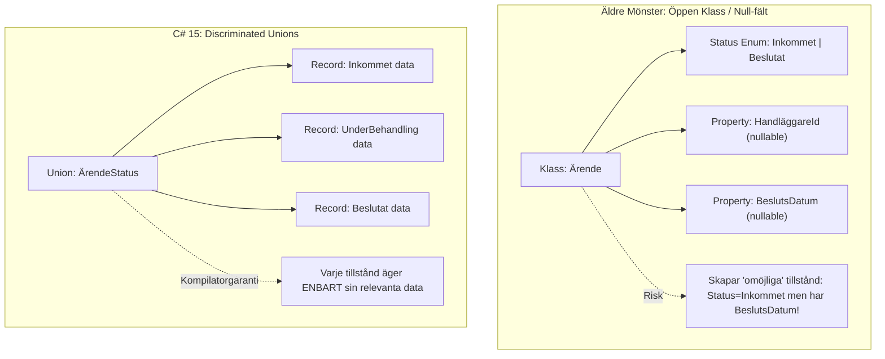
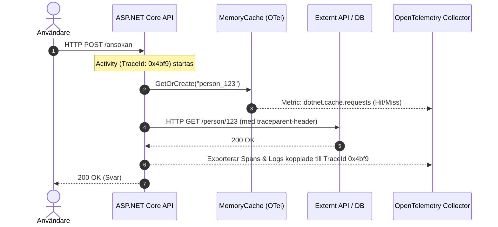
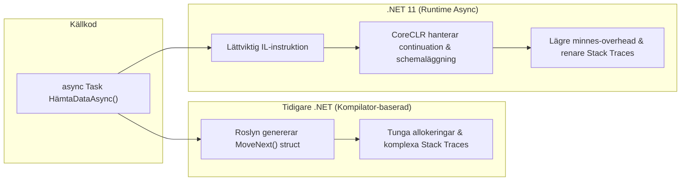

Nu är .NET 11 RC1 här: Från C# 15 Discriminated Unions till Runtime Async och Inbyggd Telemetri

Milstolpen **.NET 11 Release Candidate 1 (RC1)** har officiellt släppts med en så kallad *Go-Live license*. Det innebär att ramverket nu är funktionellt komplett, stabilt och redo för utvärdering i skarpa miljöer.

För dig som följt min bloggserie om ekosystemets utveckling – från [Historien bakom .NET (från .NET Framework till .NET 10)](https://blog.pownas.se/2026/05/24/historien-bakom-dotnet) till min förhandstitt i [Historien om .NET 11](https://blog.pownas.se/2026/05/31/historien-om-dotnet-11/) – är RC1-släppet den perfekta mätpunkten. Nu ser vi exakt vilka funktioner som landar i koden när **C# 15** blir standard.

<!--more-->
---

I denna artikel går vi på djupet med de viktigaste nyheterna, illustrerar arkitekturella vinster med Mermaid-diagram och sammanfattar vad detta innebär för moderna enterprise- och myndighetsapplikationer.

---

## 1. C# 15: Discriminated Unions och Slutna Hierarkier

Den enskilt största språkliga nyheten i C# 15 är **Discriminated Unions (`union`)**. I komplexa domäner (t.ex. ärendehandläggning, finans eller e-tjänster) har utvecklare länge tvingats modellera tillstånd med klassarv, valfria `null`-fält eller externa enums. Detta leder ofta till ogiltiga tillstånd i minnet.

Med `union` kombineras typen och datan till en sluten struktur där kompilatorn garanterar att **alla fall hanteras vid mönstermatchning (Exhaustive Pattern Matching)**.

### Kodexempel: Domänmodellering för ett processflöde

```csharp
// C# 15: Definiera ett strikt tillståndsflöde
public union ÄrendeStatus
{
    public record Inkommet(DateTime MottagetDatum, string AvsändareId);
    public record UnderBehandling(string HandläggareId, DateTime Påbörjad);
    public record KompletteringKrävs(string Skäl, DateTime SistaSvarsdatum);
    public record Beslutat(bool Beviljad, string BeslutsDokumentRef, DateTime BeslutsDatum);
}

public class ÄrendeTjänst
{
    public string SkapaNotifikation(ÄrendeStatus status) => status switch
    {
        ÄrendeStatus.Inkommet i 
            => $"Ärendet mottogs {i.MottagetDatum:yyyy-MM-dd}.",
        ÄrendeStatus.UnderBehandling u 
            => $"Handläggs av {u.HandläggareId}.",
        ÄrendeStatus.KompletteringKrävs k 
            => $"Komplettera senast {k.SistaSvarsdatum:yyyy-MM-dd}. Skäl: {k.Skäl}",
        ÄrendeStatus.Beslutat b 
            => $"Beslut fattat {b.BeslutsDatum:yyyy-MM-dd}. Utfall: {(b.Beviljad ? "Beviljad" : "Avslagen")}"
        // Om ett nytt fall läggs till i unionen ger kompilatorn ett byggfel här!
    };
}

```

### Jämförelse: Äldre mönster vs. C# 15 Unions



---

## 2. Inbyggd Observabilitet & OpenTelemetry i Bilibioteken

En av de starkaste trenderna sedan .NET 9 och 10 har varit att flytta övervakningslogik från tunga tredjepartsbibliotek direkt in i ramverkets kärna. I .NET 11 RC1 ser vi detta i full effekt:

1. **`MemoryCache` Metrics:** `IMemoryCache` har nu inbyggda OpenTelemetry-mätvärden (`dotnet.cache.requests`, `dotnet.cache.evictions`). Med `TrackStatistics = true` får du automatiskt ut hit-rate och minnestryck till Prometheus/Grafana.
2. **Deklarativ Spårning via `Microsoft.Extensions.Diagnostics`:** Konfigurera regler för `ActivitySource` och `ActivityListener` via konfigurationsfiler istället för manuell C#-kod.
3. **Automatisk Kontext-korrelation:** Alla utgående HTTP-anrop och interimsspår synkroniserar `TraceId` och `SpanId` enligt W3C Trace Context-standarden.



---

## 3. Runtime Async och Prestanda i Kärnan

I tidigare .NET-versioner byggde `async/await` på att C#-kompilatorn genererade en komplex tillståndsmaskin (struct/class) för varje asynkron metod.

I .NET 11 introduceras **Runtime Async**, där infrastruktur för asynkron exekvering flyttas direkt in i CoreCLR.



### Vinsterna i produktion:

* **Minskad Heap-allokering:** Färre tidsbegränsade objekt som belastar Garbage Collectorn (GC) i anropsintensiva mikrotjänster.
* **Tydligare Stack Traces:** Felsökning i loggar eller APM-verktyg visar de faktiska metodanropen istället för internt genererade `<>c__DisplayClass`-strukturer.

---

## 4. Övriga Viktiga Nyheter i RC1

* **Asynkron Validering i DataAnnotations:** Stöd för async-validering via `AsyncValidationAttribute` och `IAsyncValidatableObject` direkt i pipelinedatavalideringen, vilket underlättar uppslag mot externa register.
* **Nya Minnesströmmar utan Kopiakorringation:** Fyra nya stream-typer (`ReadOnlyMemoryStream`, `WritableMemoryStream`, `ReadOnlySequenceStream`, `StringStream`) tillåter läsning/skrivning av minnesbuffertar utan onödig array-kopiering.
* **System.Text.Json utökningar:** Inbyggt stöd för C# 15 unions, JSON Lines (JSONL) samt direkt stöd för IEEE 754 decimaltyper (`Decimal32`, `Decimal64`, `Decimal128`).
* **Kryptografi & Transport:** Stöd för `X25519DiffieHellman` för nyckelutbyte, opaddad AES Key Wrap (`EncryptKeyWrap`), samt automatisk TLS-kanalbindning på Unix/Linux-plattformar.

---

## Sammanfattning: Varför uppgradera eller förbereda redan nu?

.NET 11 är en **STS-release (Standard-Term Support)** med 2 års support, vilket gör den utmärkt för snabbrörliga team och moderna molnmiljöer. För organisationer med strikta förvaltningsmodeller lägger .NET 11 RC1 grunden för vad som kommer att bli nästa LTS-release (.NET 12).

| Fokusområde | Vinst med .NET 11 RC1 |
| --- | --- |
| **Kodkvalitet** | `union` eliminerar ogiltiga tillstånd i domänmodellen och minskar buggar. |
| **Drift & Övervakning** | Inbyggd OpenTelemetry i `MemoryCache` och HTTP förenklar arkitekturen. |
| **Exekvering** | Runtime Async ger lägre minnesallokering och renare spårbarhet vid fel. |
| **Säkerhet** | Moderna krypterings-APIs och skärpt TLS-validering direkt i Linux-containrar. |

---

### Relevanta källor och vidare läsning

1. **Microsoft Learn:** [What's new in .NET 11 Overview](https://learn.microsoft.com/en-us/dotnet/core/whats-new/dotnet-11/overview)
2. **.NET Blog:** [Announcing .NET 11 Release Candidate 1](https://devblogs.microsoft.com/dotnet/dotnet-11-rc-1/)
3. **InfoQ:** [Microsoft Releases .NET 11 RC1 with Go-Live Support and C# 15](https://www.infoq.com/news/2026/09/dotnet-11-rc-1-release/)
4. **Tidigare blogginlägg av författaren:**
* [Historien bakom .NET (från .NET Framework till .NET 10)](https://blog.pownas.se/2026/05/24/historien-bakom-dotnet)
* [Historien om .NET 11](https://blog.pownas.se/2026/05/31/historien-om-dotnet-11/)