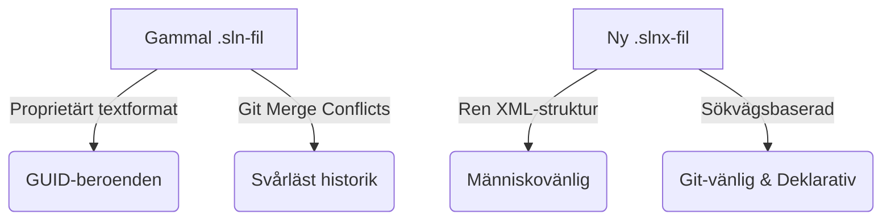
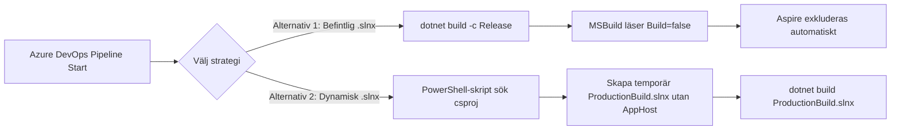

Om du någonsin har drabbats av obegripliga merge-konflikter i Git på grund av en `.sln`-fil, eller svurit över GUID-kaoset i Visual Studio, har du något väldigt trevligt att se fram emot.

I samband med utvecklingen av moderna .NET-versioner och Visual Studio har Microsoft introducerat **`.slnx` (XML Solution Format)** — en efterlängtad modernisering av den klassiska solution-filen.

I den här guiden går vi igenom allt du behöver veta om `.slnx`: från grundläggande anatomi och konvertering till avancerade byggkonfigurationer med **.NET Aspire**, **Azure DevOps pipelines** och **Docker**.

<!--more-->
---

## 1. Vad är `.slnx` och varför behöver vi det?

Den gamla `.sln`-filen skapades för över 20 år sedan. Den använde ett proprietärt textformat med egna nyckelvärdespar och unika GUID:er (Globally Unique Identifiers) för både projekttyper och enskilda projekt. Resultatet var en svårläst fil där minsta ändring i Visual Studio ledde till gigantiska och obegripliga Git-diffar.

`.slnx` ersätter detta gamla format med **ren, deklarativ XML** som följer samma designfilosofi som `.csproj` och MSBuild.

### De tre största fördelarna med `.slnx`:

1. **Slut på GUID-kaos:** Projekt identifieras med sin relativa filväg. Inga godtyckliga GUID:er skapas längre.
2. **Konfliktfria Git-mergar:** Eftersom strukturen är ren och avskalad uppstår sällan konflikt-feber när flera i teamet lägger till filer eller projekt samtidigt.
3. **Människovänligt:** Du kan äntligen öppna solution-filen i en texteditor, förstå vad som står där och redigera den för hand utan att riska att pajade interna referenser förstör projektet.



---

## 2. Så konverterar du till `.slnx`

Att gå över till det nya formatet kräver ingen stor migration. Du kan göra det direkt i Visual Studio eller via Terminalen.

### Alternativ A: I Visual Studio

1. Öppna din befintliga `.sln`-solution i Visual Studio.
2. Gå till **File** $\rightarrow$ **Save Solution As...** (eller *Spara lösning som...*).
3. Välj filtypen **XML Solution File (`*.slnx`)** i rullgardinsmenyn och spara.

### Alternativ B: Via .NET CLI

I nyare .NET SDK:er kan du konvertera direkt från kommandoraden med ett enda kommando:

```bash
dotnet sln migrate

```

---

## 3. Grundläggande anatomi i en `.slnx`-fil

Låt oss titta på hur en komplett `.slnx`-fil ser ut. Här ser vi hur enkelt det är att deklarera projekt, strukturera upp mappar, knyta lösningsobjekt (solution items) och sätta konfigurationer.

```xml
<Solution>
  <!-- 1. Deklarera lösningens konfigurationer och plattformar -->
  <Configurations>
    <Platform Name="Any CPU" />
    <Configuration Name="Debug" />
    <Configuration Name="Release" />
  </Configurations>

  <!-- 2. Solution Items och Solution Folders -->
  <Folder Name="/Documentation/">
    <File Path="README.md" />
    <File Path="docs/architecture.drawio" />
  </Folder>

  <Folder Name="/Configuration/">
    <File Path="Directory.Build.props" />
    <File Path="Directory.Packages.props" />
    <File Path="global.json" />
  </Folder>

  <!-- 3. Ordinarie projektreferenser -->
  <Project Path="src/MyApi/MyApi.csproj" />
  <Project Path="src/CoreServices/CoreServices.csproj" />
  
  <!-- 4. Projekt placerade i nästlade Solution Folders -->
  <Folder Name="/Tests/">
    <Project Path="tests/MyApi.Tests/MyApi.Tests.csproj" />
  </Folder>

  <!-- 5. Globala egenskaper och inställningar -->
  <Properties Name="VisualStudio">
    <Property Name="OpenWith" Value="17" />
  </Properties>
</Solution>

```

### Vad betyder de olika delarna?

* **`<Project Path="..."/>`**: Deklarerar ett projekt. Sökvägen är relativ till `.slnx`-filen. Det behövs inga Type-GUID:er — SDK:n förstår automatiskt om det är C#, F#, C++, VB.NET eller Docker Compose (`.dcproj`).
* **`<Folder Name="..."/>`**: Skapar virtuella mappar i Solution Explorer. Mappar kan nästlas via XML-hierarkier eller genom sökvägssyntax (t.ex. `Name="/Parent/Child/"`).
* **`<File Path="..."/>`**: Solution Items! Perfekt för centrala filer som inte tillhör ett enskilt projekt, till exempel `README.md`, `Directory.Packages.props` (Central Package Management) eller CI/CD-pipelines.
* **`<Properties>`**: Sätter globala MSBuild- och Visual Studio-egenskaper på lösningnivå.

---

## 4. Avancerat: Villkorlig byggnation (T.ex. Inkludera/Exkludera Aspire)

En fantastisk funktion i `.slnx` är möjligheten att styra **byggmatrisen** på projektnivå.

Ett väldigt vanligt scenario i modern .NET-utveckling är när man använder **.NET Aspire** för lokal orkestrering. I `Debug`-läge vill utvecklaren ha igång Aspire AppHost för att smidigt köra igång hela sin mikrotjänstmiljö. Men när koden ska byggas i CI/CD i `Release`-läge vill vi **inte** att Aspire-orkestratorn ska byggas eller inkluderas.

I `.slnx` löses detta genom elementet `<Build ... Build="false"/>`:

```xml
<Solution>
  <Configurations>
    <Platform Name="Any CPU" />
    <Configuration Name="Debug" />
    <Configuration Name="Release" />
  </Configurations>

  <!-- Vanliga tjänster som byggs i ALLA konfigurationer -->
  <Project Path="src/MyApi/MyApi.csproj" />
  <Project Path="src/CoreServices/CoreServices.csproj" />

  <!-- .NET Aspire AppHost: Inkluderas BARA i Debug -->
  <Project Path="src/MyAspireApp.AppHost/MyAspireApp.AppHost.csproj">
    <!-- Instruerar MSBuild/VS att helt ignorera projektet i Release -->
    <Build Solution="Release|Any CPU" Build="false" />
  </Project>
</Solution>

```

### Hur det fungerar i praktiken:

* **När du kör `dotnet build -c Debug`:** Alla projekt inklusive `.AppHost` byggs.
* **När du kör `dotnet build -c Release`:** MSBuild läser regeln och **hoppar över** `MyAspireApp.AppHost.csproj`.
* **I Visual Studio:** Om du växlar över dropdown-menyn till *Release* bockas bygg-rutan automatiskt ur i Visual Studios *Configuration Manager*.

---

## 5. Integrera `.slnx` i en Azure DevOps Pipeline

Hur hanterar vi detta i en automatiserad CI/CD-pipeline? Det finns två utmärkta tillvägagångssätt.



### Alternativ 1: Använd den befintliga `.slnx`-filen (Enklast)

Eftersom din `.slnx`-fil redan innehåller regeln `<Build Build="false" Solution="Release|Any CPU"/>` behöver du inte göra något krångligt i pipelinen. Kör bara ett standard byggsteg med `-c Release`:

```yaml
trigger:
  - main

pool:
  vmImage: 'ubuntu-latest'

steps:
- task: UseDotNet@2
  inputs:
    packageType: 'sdk'
    version: '9.x'

- task: DotNetCoreCLI@2
  displayName: 'Bygg Solution i Release (Hoppar automatiskt över Aspire)'
  inputs:
    command: 'build'
    projects: 'MySolution.slnx'
    arguments: '-c Release'

```

### Alternativ 2: Generera en helt ny, ren `.slnx` dynamiskt i pipelinen

Om du föredrar att pipelinen genererar en helt ren solution-fil som enbart inkluderar exakt de projekt som ska med till produktion (och helt bortser från din lokala `.slnx`), kan du använda .NET CLI tillsammans med PowerShell:

```yaml
trigger:
  - main

pool:
  vmImage: 'ubuntu-latest'

steps:
- task: UseDotNet@2
  inputs:
    packageType: 'sdk'
    version: '9.x'

- task: PowerShell@2
  displayName: 'Generera dynamisk .slnx utan Aspire'
  inputs:
    targetType: 'inline'
    script: |
      # 1. Skapa en ny tom solution med det nya .slnx-formatet
      dotnet new sln -n ProductionBuild --format slnx

      # 2. Sök upp alla .csproj-filer men filtrera bort Aspire AppHost
      $projects = Get-ChildItem -Recurse -Filter *.csproj | 
                  Where-Object { $_.FullName -notlike "*AppHost*" } | 
                  Select-Object -ExpandProperty FullName

      # 3. Lägg till de godkända projekten i den nya .slnx-filen
      foreach ($proj in $projects) {
          dotnet sln ProductionBuild.slnx add $proj
      }

      Write-Host "Genererad .slnx-fil innehåller följande projekt:"
      Get-Content ProductionBuild.slnx

- task: DotNetCoreCLI@2
  displayName: 'Bygg den dynamiskt genererade solution-filen'
  inputs:
    command: 'build'
    projects: 'ProductionBuild.slnx'
    arguments: '-c Release'

```

---

## 6. Hantera `.slnx` i en Multi-Stage Dockerfile

När du bygger Docker-images för dina tjänster vill du hålla din Docker-build-kontext så ren och snabb som möjligt.

När du använder `.slnx` i Docker har du två bra mönster:

### Mönster A: Bygg via `.slnx` med `-c Release`

I det här mönstret kopierar du in din `.slnx`-fil och dina projektfiler. När du kör `dotnet publish -c Release` exkluderas Aspire automatiskt av MSBuild tack vare konfigurationen i `.slnx`. Du behöver inte ens kopiera över Aspire-källkoden till Docker-containern!

```dockerfile
# STAGE 1: Build
FROM mcr.microsoft.com/dotnet/sdk:9.0 AS build
WORKDIR /src

# 1. Kopiera solution-filen och projektfilerna för effektiv restore-caching
COPY ["MySolution.slnx", "./"]
COPY ["src/MyApi/MyApi.csproj", "src/MyApi/"]
COPY ["src/CoreServices/CoreServices.csproj", "src/CoreServices/"]

# 2. Återställ beroenden
RUN dotnet restore "MySolution.slnx"

# 3. Kopiera resten av källkoden (exklusive AppHost om du vill)
COPY . .

# 4. Publicera specifik tjänst eller hela solutionen i Release mode.
# Eftersom .slnx har Build="false" för Release hoppas Aspire över helt.
RUN dotnet publish "src/MyApi/MyApi.csproj" -c Release -o /app/publish /p:UseAppHost=false

# STAGE 2: Runtime
FROM mcr.microsoft.com/dotnet/aspnet:9.0 AS final
WORKDIR /app
COPY --from=build /app/publish .
ENTRYPOINT ["dotnet", "MyApi.dll"]

```

### Mönster B: Direkt mot `.csproj` (Oberoende av solution-filen)

I ren mikrotjänstarkitektur är det ofta ännu bättre att låta Docker-filen vara helt oberoende av solution-filen och bara bygga det specifika API:et direkt:

```dockerfile
FROM mcr.microsoft.com/dotnet/sdk:9.0 AS build
WORKDIR /src

# Kopiera endast den relevanta tjänsten och dess interna bibliotek
COPY ["src/MyApi/MyApi.csproj", "src/MyApi/"]
COPY ["src/CoreServices/CoreServices.csproj", "src/CoreServices/"]

RUN dotnet restore "src/MyApi/MyApi.csproj"

COPY src/MyApi/ src/MyApi/
COPY src/CoreServices/ src/CoreServices/

WORKDIR "/src/src/MyApi"
RUN dotnet publish "MyApi.csproj" -c Release -o /app/publish /p:UseAppHost=false

FROM mcr.microsoft.com/dotnet/aspnet:9.0 AS final
WORKDIR /app
COPY --from=build /app/publish .
ENTRYPOINT ["dotnet", "MyApi.dll"]

```

---

## Sammanfattning: Checklista för `.slnx`

* **Skapa/Migrera:** Använd `dotnet sln migrate` eller *Save As* i Visual Studio för att ta steget bort från gamla `.sln`.
* **Organisera:** Använd `<Folder>` och `<File>` för att hålla ordning på arkitekturritningar, `.props`-filer och pipeline-skript direkt i Solution Explorer.
* **Bygg-styrning:** Använd `<Build Build="false" Solution="Release|Any CPU"/>` för att exkludera utvecklingsverktyg som .NET Aspire i produktion.
* **CI/CD:** Använd antingen befintlig `.slnx`-fil i `Release`-läge, eller nyttja `dotnet new sln --format slnx` i dina pipelines för dynamiska byggen.

Det nya `.slnx`-formatet gör städningen i .NET-ekosystemet komplett. Det är dags att vinka adjö till 20 år gamla GUID-filer och välkomna en renare utvecklarvardag!

Här är en sammanställd referenslista med relevanta källor och dokumentationslänkar som fördjupar de koncept kring `.slnx`, MSBuild och .NET Aspire som togs upp i guiden.

---

### Referenslista & Källor

#### Officiell Microsoft Dokumentation (`learn.microsoft.com`)

1. **Microsoft Learn – Solution files in Visual Studio and .NET CLI**
* *Beskrivning:* Officiell dokumentation om hur solution-filer hanteras i .NET-ekosystemet samt introduktionen av det nya XML-baserade `.slnx`-formatet.
* *Länk:* [learn.microsoft.com/visualstudio/ide/solutions-and-projects-in-visual-studio](https://learn.microsoft.com/visualstudio/ide/solutions-and-projects-in-visual-studio)


2. **Microsoft Learn – .NET CLI `dotnet sln` Command**
* *Beskrivning:* Referensguide för `.NET CLI`-kommandon, inklusive hantering av solution-filer, migrering med `dotnet sln migrate` och skapande av nya solution-filer med formatflaggor.
* *Länk:* [learn.microsoft.com/dotnet/core/tools/dotnet-sln](https://learn.microsoft.com/dotnet/core/tools/dotnet-sln)


3. **Microsoft Learn – Configure Build Configurations in Visual Studio**
* *Beskrivning:* Förklaring av hur konfigurationer (`Debug` / `Release`) och plattformsmappningar fungerar på lösning- och projektnivå i Visual Studio och MSBuild.
* *Länk:* [learn.microsoft.com/visualstudio/ide/understanding-build-configurations](https://learn.microsoft.com/visualstudio/ide/understanding-build-configurations)


4. **Microsoft Learn – .NET Aspire Overview & Tooling**
* *Beskrivning:* Genomgång av .NET Aspire, hur `AppHost`-projektet fungerar och rekommenderade mönster för att exkludera orkestrering vid produktionsbyggen och i Docker-miljöer.
* *Länk:* [learn.microsoft.com/dotnet/aspire/get-started/aspire-overview](https://learn.microsoft.com/dotnet/aspire/get-started/aspire-overview)


5. **Microsoft Learn – Containerize a .NET app with `dotnet publish**`
* *Beskrivning:* Officiell guide för hur du bygger och publicerar .NET-applikationer i Docker och kontaineriserade miljöer.
* *Länk:* [learn.microsoft.com/dotnet/core/docker/build-container](https://learn.microsoft.com/dotnet/core/docker/build-container)


---

#### GitHub & Community-källor

6. **MSBuild Repository (GitHub) – XML Solution Format Specification (`.slnx`)**
* *Beskrivning:* MSBuilds officiella GitHub-repository där specifikationen, XML-schemat och diskussionerna bakom det nya `.slnx`-formatet finns dokumenterade.
* *Länk:* [github.com/dotnet/msbuild](https://github.com/dotnet/msbuild)


7. **Developer Community (Microsoft) – Proposal for Human-Readable Solution Files**
* *Beskrivning:* Baksidan och utvecklardiskussionen i Microsoft Developer Community som ledde fram till ersättandet av det klassiska `.sln`-formatet med `.slnx`.
* *Länk:* [developercommunity.visualstudio.com](https://developercommunity.visualstudio.com)


8. **Azure DevOps Pipelines Schema Reference (`azure-pipelines.yml`)**
* *Beskrivning:* Dokumentation och syntaxreferens för byggsteg som `PowerShell@2`, `UseDotNet@2` och `DotNetCoreCLI@2` i Azure Pipelines.
* *Länk:* [learn.microsoft.com/azure/devops/pipelines/yaml-schema](https://learn.microsoft.com/azure/devops/pipelines/yaml-schema)
